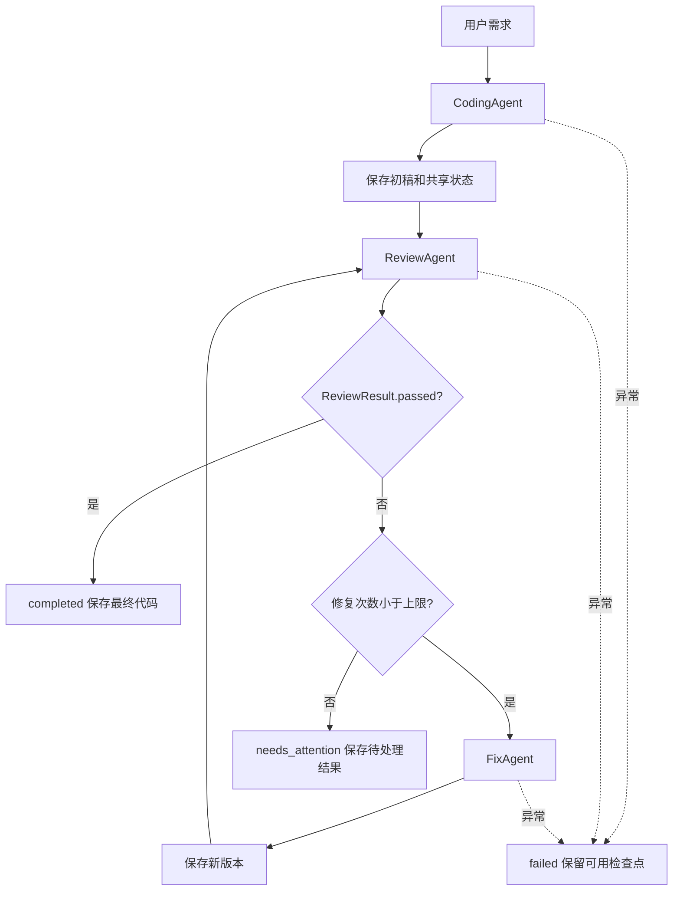

# Homework 2 设计文档

## 目标与范围

本项目实现新版 PPT 中的代码审查 Workflow。用三个 Agent 展示顺序编排、状态共享、条件分支与有界循环。保留已有模型连接配置和 Homework 1 审查工具，不引入第三方调度框架。处理单个 Python 模块，不执行生成代码。

## 总体流程

默认 max_fixes=2，允许 0–5。修复次数 revision 与审查轮数 iteration 分开计数：初稿 revision=0，第一次审查后 iteration=1；修复两次后最多完成三轮审查。任何最后一次修复仍需复审。只有当前版本通过才能 completed。

## 模块与职责

- code_review_agent：复用原 ReviewAgent 的有界工具调用循环、ChatClient 的重试和脱敏、WorkspaceTools 的路径限制及 AST 分析。
- workflow/state.py：WorkflowState 和 ReviewResult 数据结构。
- workflow/base_agent.py：统一 run(state) -> state 契约。
- workflow/coding_agent.py、review_agent.py、fix_agent.py：三个独立角色节点。
- workflow/engine.py：调用节点、落盘、执行日志和状态转换。
- workflow/cli.py：演示入口、需求输入和已有模型选择功能。
- scripts/package_submission.py：提交物白名单和密钥检查。

三个角色可共享无会话的 ChatClient，但系统提示与消息上下文独立。ReviewAgent 每轮清空旧记忆，防止沿用旧版本的证据。Agent 不调用其他 Agent，由 WorkflowEngine 统一调度。

## 状态与通信协议

| 字段 | 含义 |
| --- | --- |
| requirement | 原始用户需求，最多 8000 字符 |
| run_dir | 本次运行目录 |
| code / code_path | 当前源码及版本文件名 |
| review_result | 最近一次 ReviewResult |
| final_code | 正常终止时最后完成审查的源码 |
| current_step / stage | 当前阶段，两个名称指向同一值 |
| iteration | 已完成审查次数 |
| revision | 已完成修复版本编号 |
| status / error | 运行状态和错误信息 |
| reviews | 历次审查结果 |
| events | 编排阶段记录 |
| logs | 阶段完成与工具调用明细 |

ReviewResult 包含 passed、summary、issues、static_analysis 和 revision。每个 issue 有 severity、line、message、suggestion。模型侧沿用 approved 布尔字段，通过适配转换为 passed；这样保留旧模型协议，同时让引擎通过 state.review_passed 判断。

JSON 必须结构有效，通过标记必须与空问题列表一致。不通过搜索“通过”等文字判断分支。审查前读取当前文件做 AST 检查，并向模型提供完整源码和静态结果；模型还可用文件工具核对证据。语法错误强制否决模型的通过结论。

每个节点接收共享状态的工作副本。节点成功返回同一副本后才提交状态字段；抛出异常时保留此前状态。节点不能修改原始需求或输出目录，写入路径由引擎决定。执行过程中产生的工具日志由引擎记录并保留。

## 日志和文件

每次运行建立独立目录，源码版本只新增。state.json 先写临时文件再替换；workflow.log 以 JSON Lines 追加，包含 UTC 时间、节点、状态、修复版本和说明。终端 --verbose 展示同一事件流。report.md 汇总各轮问题和结束状态。

默认不自动恢复旧状态；用户可查看失败记录后重新运行。磁盘权限、磁盘空间或 I/O 故障时，保存只能尽力进行，不能保证检查点和日志写入。故障处理中的二次保存异常不会覆盖原始业务错误。

## 模型与凭据

沿用现有 .env，重构不迁移、不覆盖 API Key。两个新入口和旧入口共享 model_options.py。支持 DeepSeek、Ollama 和自定义 Chat Completions 服务，以及 --model、--select-model、--list-models、--check-connection。

DeepSeek 专用密钥仅用于对应主机；custom 使用 LLM_API_KEY；本地 Ollama 使用占位认证值。模型请求只在有工具时发送 tools 和 tool_choice。客户端保留原超时、有限网络重试、禁止认证重定向和服务错误脱敏。

源码和需求可能发送到所选模型服务。工具只能读取指定运行目录内的允许文件，不提供执行能力。模型审查和 AST 都可能误报或漏报；通过审查不等于通过运行测试。

## 扩展方式

实现 BaseAgent.run(state) 并显式更新输出字段。通过 WorkflowEngine 的 coding_agent、review_agent、fix_agent 参数替换对应节点。新增第四个节点时，在引擎中明确其调用位置、状态输出及失败策略，并使用相同的日志和检查点方法。例如新增文档节点可以读取 final_code 并生成说明；执行测试的节点需要额外的受限执行环境，本项目没有提供该环境。

CLI 仍兼容 python -m code_review_agent.workflow；新推荐入口为 python main.py。原来返回源码字符串的节点 API 改为返回 WorkflowState，调用者从 state.code 读取输出。

