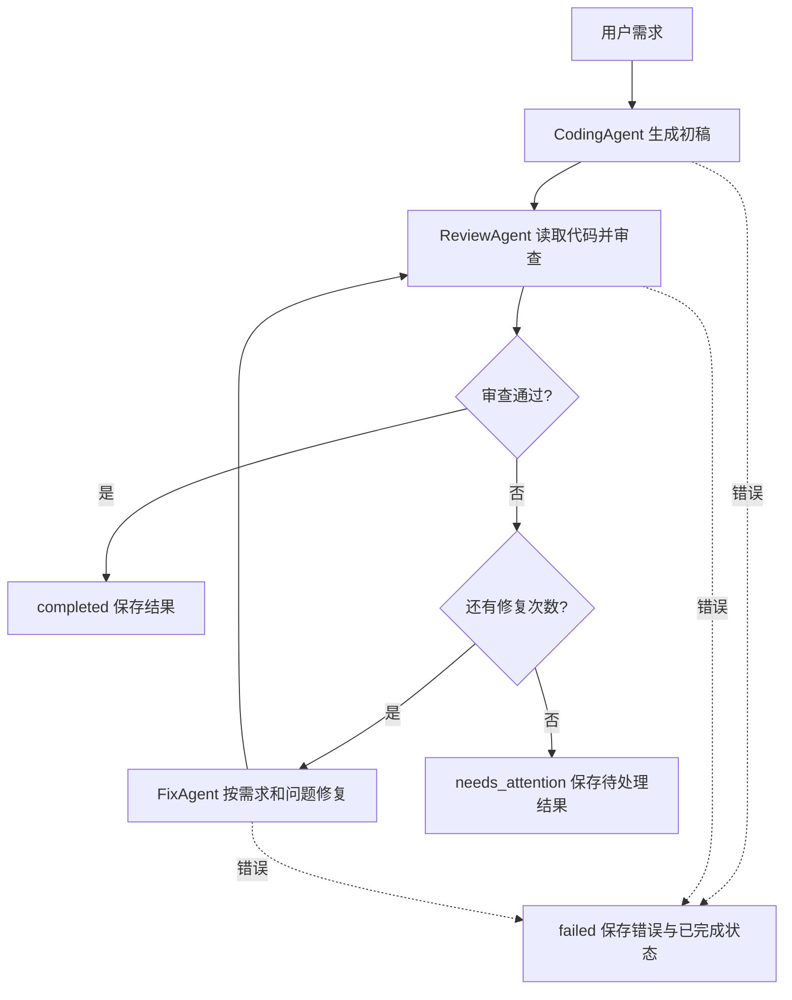

# Homework 2 设计说明

## 目标与流程

选择作业中的代码审查方向，复用 Homework 1 的模型客户端、ReviewAgent 和只读工具。三个 Agent 通过 WorkflowState 共享任务信息，由 Workflow 决定调用顺序。

## 职责与通信

| 组件 | 输入 | 输出 |
| --- | --- | --- |
| CodingAgent | requirement | 完整 Python 源码 |
| ReviewNode / ReviewAgent | requirement、当前代码路径、工具读取结果 | approved、summary、issues |
| FixAgent | requirement、当前源码、最新审查结果 | 完整修复源码 |
| Workflow | 三个节点及修复上限 | 顺序执行、分支控制、版本与结果保存 |

CodingAgent 与 FixAgent 使用不同系统提示和独立请求上下文。ReviewNode 每轮清空旧审查记忆，使用 Homework 1 ReviewAgent.ask 的工具循环。它们可以共享无会话的 ChatClient 实例，但不共享角色提示或模型消息历史。角色间通过显式状态字段传递数据。

WorkflowState 包含 requirement、run_dir、status、stage、revision、code、code_path、reviews、events、error。每次状态变化保存 state.json，采用临时文件后替换的方式避免半写 JSON。events 记录 UTC 时间、阶段、版本、事件说明。源码版本只新增，失败的修复不会覆盖已有源码。

审查协议要求 approved 为布尔值、summary 为非空文本、issues 为问题列表。每个问题包含 severity（high/medium/low）、正整数 line、message 和 suggestion。只有空问题列表才能通过。无效或矛盾的 JSON 使流程失败，不靠搜索“通过”等关键词决定分支。每轮额外执行 AST 语法检查，语法错误会强制进入修复或待处理状态。

## 执行边界与错误处理

需求最多 8000 字符，单版源码最多 32000 字符，默认最多 1 次修复（可设 0–5）。每轮 ReviewAgent 最多 8 次模型决策。原客户端继续处理网络重试；生成源码时不传空 tools 数组和 tool_choice，审查时仍传完整工具定义。

模型不获得写入或代码执行工具。Workflow 将生成源码写入新建的运行目录，以该目录为 ReviewAgent 的读取根目录。保留原工具的路径、编码、文件大小限制。生成代码和审查结论都可能有误；本 MVP 不执行任意生成代码，也不保证运行时正确性。

模型网络故障、空代码、无效审查结构等会终止流程并记录错误。尽量保留报告和检查点，但磁盘不可写时不能保证保存成功。支持重新发起任务，不提供自动从 state.json 恢复。修复次数用尽是 needs_attention，不伪报成功。

## 扩展方式

CodingAgent 与 FixAgent 都采用 run(state) 接口，可向 Workflow 构造函数注入替代实现。ReviewNode 是旧 Agent 的适配层，可替换为其他审查节点。增加新的节点时，应明确读取和写入的状态字段，并在编排层安排调用与错误记录。未来执行测试需增加独立的受限执行环境，当前流程不自动运行模型代码。

## 作业要求对应

| 评审维度 | 实现 |
| --- | --- |
| 完整流程 | 需求 → 编码 → 审查 → 修复 → 复审 → 结果落盘 |
| Agent 协作 | 三个角色、独立提示、共享状态、结构化审查传递 |
| 顺序执行 | Workflow.run 明确编排调用顺序 |
| 推荐功能 | 条件分支、有界修复循环、执行日志、失败状态保留 |
| 可扩展性 | 客户端接口复用、run(state) 节点接口、旧 Agent 适配 |
| 文档 | README 使用说明、本文件流程图及架构说明 |

## 验证

### 模型连接与审查更新

model_options.py 为两个 CLI 统一提供服务选择、模型列表、交互选择、聊天连接测试。llm.py 按 provider 解析配置，隔离 DeepSeek、custom、Ollama 的专用密钥。切换 provider 时不继承其他 profile 的旧地址和旧模型。服务端模型列表不能证明其工具调用能力，必须通过实际工作流确认。

ReviewNode 使用单独的 JSON 系统提示，避免继承原文字报告要求。发起审查前执行 AST 检查，并将完整源码和 AST 结果放入任务上下文，因此模型即使未主动读文件也能获得当前版本的完整证据。Workflow 专用输入上限为 256000 字符，以容纳源码和 JSON 转义；旧单 Agent 入口仍为 12000 字符。语法错误会强制否决审查通过标记。

追加 tests/test_model_options.py 覆盖配置优先级、服务切换、密钥隔离、模型列表协议、交互选择、连接测试、非法响应和参数冲突。

tests/test_workflow.py 覆盖离线端到端、共享状态传递、首轮通过跳过修复、修复上限、异常和格式错误、语法检查否决、重复运行隔离、CLI 退出码和无工具请求协议。tests/test_agent.py 保留原有工具、记忆、网络重试等回归测试。真实模型的可用性和输出质量需配置有效 API Key 后验证。
